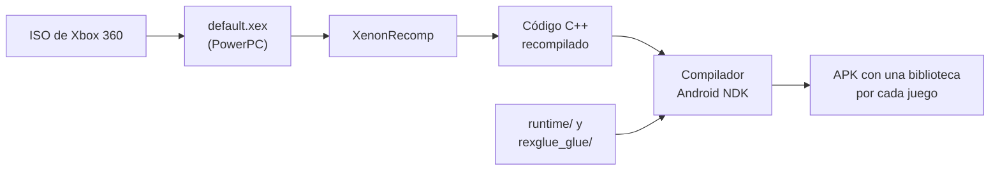
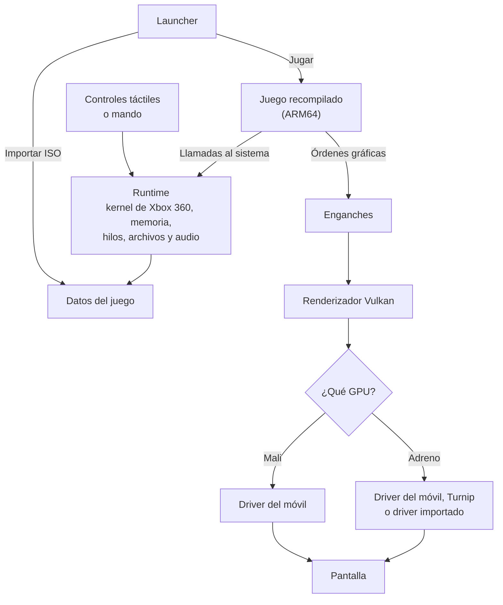

# LibertyDroid

**Español** | [English](README.en.md)

Port nativo y no oficial de **Grand Theft Auto IV** y **Episodes from Liberty City** (Xbox 360) a **Android**, con launcher propio.

El juego no se emula. Su ejecutable de Xbox 360 se recompila a código nativo ARM64 y se dibuja con un renderizador Vulkan. El proyecto también incluye el launcher que importa el juego, lo configura y lo arranca.

## Índice

- [Requisitos](#requisitos)
- [Qué incluye](#qué-incluye)
- [Cómo funciona](#cómo-funciona)
- [Dependencias](#dependencias)
- [Compilar](#compilar)
- [Estructura del repositorio](#estructura-del-repositorio)
- [Créditos](#créditos)
- [Licencia](#licencia)
- [Aviso legal](#aviso-legal)

## Requisitos

| Componente | Requisito |
|---|---|
| **Sistema** | Android 10 o superior |
| **CPU** | ARM de 64 bits (`arm64-v8a`). No hay un mínimo de potencia medido, pero el rendimiento depende sobre todo de la CPU |
| **GPU** | Vulkan 1.2 con las funciones de abajo, en el driver del móvil o en Turnip |
| **Memoria** | 1,5 GB libres al arrancar. Con menos, el launcher avisa de que cierres otras apps |
| **Almacenamiento** | Unos 6,6 GB libres por juego, además de la ISO mientras se importa (7,3 GB la de GTA IV) |
| **Juego** | ISO de la **versión USA** de GTA IV o de Episodes from Liberty City, sin actualizaciones |
| **Controles** | Táctiles, incluidos, o mando |

**Funciones de Vulkan que necesita el renderizador:**

- `depthClamp`, `sampleRateShading` e `independentBlend`.
- Indexación de descriptores (`runtimeDescriptorArray` y `descriptorBindingPartiallyBound`).
- `bufferDeviceAddress`.
- Renderizado dinámico (Vulkan 1.3 o `VK_KHR_dynamic_rendering`).

`shaderInt64` no es obligatorio: sin él, los shaders usan pares de 32 bits.

**Según la GPU:**

- **Adreno:** si el driver del móvil no cumple los requisitos, el juego usa el Turnip incluido, siempre que ese Adreno sea compatible con él.
- **Mali:** usa siempre el driver del móvil, que debe cumplirlos.
- **Otras GPU:** no se han probado. El launcher comprueba el driver y bloquea el juego si le falta algo.

**Versiones del juego:** otras regiones o versiones con actualizaciones no coinciden con el código recompilado, y el launcher las rechaza.

| Juego | Title ID | Media ID | Versión de `default.xex` |
|---|---|---|---|
| GTA IV | `545407F2` | `6AC07221` | 5 |
| Episodes from Liberty City | `545407F2` | `06759F9C` | 10 |

## Qué incluye

### Launcher

Launcher nativo en C++, con ImGui sobre OpenGL ES 3:

- **Importar ISO:** instala el juego desde la ISO, sin copiar archivos con adb.
- **Elegir juego:** GTA IV o Episodes from Liberty City, desde una misma app.
- **Gráficos:** perfiles Ultra rendimiento, Rendimiento, Predeterminado, Calidad y Nativo (Xbox 360), más un modo Personalizado con sombras, distancia de visión, detalle, población y reflejos.
- **GPU y drivers:** en Adreno se elige entre automático, el driver del sistema, Turnip o un driver de AdrenoTools importado. Si el importado no sirve, se aplica la elección automática.
- **Partidas:** copias de seguridad manuales y automáticas, y restauración.
- **Controles:** táctiles configurables (opacidad, tamaño, vibración) y mando.
- **Sistema:** idioma, contador de FPS, comprobación de los archivos del juego y consulta del último error.
- **Idiomas:** español, inglés, francés, alemán e italiano, también para el juego.

### Port

- Kernel de Xbox 360 reimplementado: memoria, hilos, archivos, entrada y partidas guardadas.
- Renderizador nativo Vulkan, con antialiasing FXAA y SMAA.
- Sombras del sol estabilizadas al conducir.
- Niebla y distancia de visión ajustables, con distancia dinámica.
- Fuentes vectoriales para que los textos se vean nítidos.
- Soporte de pantallas panorámicas de móvil, minimapa incluido.
- Pausa y retención de los hilos cuando la app pasa a segundo plano.
- Protecciones frente a fallos del motor de físicas y del grupo de tareas del juego.
- Shaders sin `shaderInt64`, para GPU que no lo tienen.
- Una ventana de prueba para PC con teclado y mando (`GTA4_PC_WINDOW=1`).

## Cómo funciona

1. **Recompilación estática:** [XenonRecomp](https://github.com/hedge-dev/XenonRecomp) traduce el PowerPC del `default.xex` a C++, y este se compila para ARM64.
2. **Runtime:** `runtime/` sustituye al sistema de la consola. Implementa las funciones del kernel y de XAM que usa el juego, y resuelve la memoria y el orden de bytes.
3. **Enganches:** `rexglue_glue/` reemplaza funciones concretas del juego por versiones propias, identificadas por su dirección.
4. **Renderizador:** los enganches interceptan las órdenes gráficas del juego y las dibuja un renderizador Vulkan basado en LibertyRecomp, con los shaders de Xbox 360 traducidos.
5. **Dos juegos, un código:** las fuentes se escriben para las direcciones de Episodes from Liberty City. `tools/gen_iv_sources.py` genera la copia de GTA IV durante la compilación, usando las tablas de `analysis/gta4/`.
6. **Drivers en Adreno:** [libadrenotools](https://github.com/bylaws/libadrenotools) carga Turnip o un driver importado cuando el del móvil no es suficiente.

### Diagramas

**Del disco a la app:**



**Mientras se juega:**



## Dependencias

`tools/fetch-deps.sh` descarga las principales en la versión exacta usada y aplica los cambios de `patches/`.

### Recompilación y base

| Proyecto | Uso | Licencia |
|---|---|---|
| [XenonRecomp](https://github.com/hedge-dev/XenonRecomp) | Recompilador de PowerPC a C++ (con parche) | MIT |
| [XenosRecomp](https://github.com/sonicnext-dev/XenosRecomp) | Traducción de shaders de Xbox 360 | MIT |
| [LibertyRecomp](https://github.com/vaduur/LibertyRecompAndroid) | Renderizador nativo, enganches y recursos | GPL-3.0 |
| ReXGlue | Base del renderizador y del runtime (incluida, con cambios) | BSD |
| [Xenia Canary](https://github.com/xenia-canary/xenia-canary) | GPU y bibliotecas auxiliares (con parche) | BSD |

### Android y GPU

| Proyecto | Uso | Licencia |
|---|---|---|
| [libadrenotools](https://github.com/bylaws/libadrenotools) | Carga de drivers propios en Adreno | BSD-2-Clause |
| [Turnip (Mesa)](https://github.com/K11MCH1/AdrenoToolsDrivers) | Driver Vulkan para Adreno, v26.0.0-rc08 | MIT |
| [Vulkan-Headers](https://github.com/KhronosGroup/Vulkan-Headers) | Cabeceras de Vulkan | Apache-2.0 / MIT |
| [volk](https://github.com/zeux/volk) | Cargador de Vulkan | MIT |
| [VulkanMemoryAllocator](https://github.com/GPUOpen-LibrariesAndSDKs/VulkanMemoryAllocator) | Memoria de la GPU | MIT |
| [SPIRV-Headers](https://github.com/KhronosGroup/SPIRV-Headers), [SPIRV-Tools](https://github.com/KhronosGroup/SPIRV-Tools) | Procesado de SPIR-V | MIT, Apache-2.0 |
| [glslang](https://github.com/KhronosGroup/glslang) | Compilador de GLSL | BSD y otras |
| [DXC (binarios)](https://github.com/renderbag/dxc-bin) | Compilador de HLSL, solo al compilar | NCSA y otras |
| [smol-v](https://github.com/aras-p/smol-v) | Compresión de SPIR-V | MIT / dominio público |

### Bibliotecas

| Proyecto | Uso | Licencia |
|---|---|---|
| [o1heap](https://github.com/pavel-kirienko/o1heap) | Montón del juego | MIT |
| [unordered_dense](https://github.com/martinus/unordered_dense) | Tablas hash | MIT |
| libmspack (incluida) | Descompresión LZX | LGPL-2.1 |
| [zstd](https://github.com/facebook/zstd) | Compresión | BSD / GPL-2.0 |
| [snappy](https://github.com/google/snappy) | Compresión | BSD-3-Clause |
| [FFmpeg](https://github.com/has207/FFmpeg) | Decodificación del audio XMA | LGPL / GPL |
| [Dear ImGui](https://github.com/ocornut/imgui) | Interfaz del launcher | MIT |
| [simde](https://github.com/simd-everywhere/simde) | SIMD portable | MIT |
| [spdlog](https://github.com/gabime/spdlog), [fmt](https://github.com/fmtlib/fmt) | Registro y formato de texto | MIT |
| [toml++](https://github.com/marzer/tomlplusplus) | Lectura de TOML | MIT |
| [CLI11](https://github.com/CLIUtils/CLI11) | Línea de órdenes | BSD-3-Clause |
| [xxHash](https://github.com/Cyan4973/xxHash) | Hashes | BSD-2-Clause |
| [utfcpp](https://github.com/nemtrif/utfcpp) | Texto UTF-8 | BSL-1.0 |
| picosha2, RenderDoc API (incluidas) | SHA-256 y depuración gráfica | MIT |

## Compilar

> **Aviso:** todavía no se ha probado compilar desde un clon limpio. Es probable que algún paso necesite ajustes.

**Hace falta:** Windows con Git Bash, Python 3 y Node.js; Android SDK (build-tools 36.0.0, plataforma 34, CMake 3.31.6) y NDK 27.2.12479018; JDK y Visual Studio Build Tools 2022.

1. **Dependencias:** desde la raíz del repositorio, ejecuta `bash tools/fetch-deps.sh`. Descarga Turnip de [AdrenoToolsDrivers](https://github.com/K11MCH1/AdrenoToolsDrivers) y colócalo en `third_party/turnip/v26.0.0-R8/`.
2. **Archivos de LibertyRecomp:** copia `LibertyRecompLib` de [LibertyRecomp](https://github.com/vaduur/LibertyRecompAndroid) en `third_party/rexglue/` y genera las cachés de shaders. `rexglue_glue/shader_override_cache.cpp` se genera con `tools/gta4_shader_override_compiler.py`.
3. **Recompilar el juego:** extrae `default.xex` de la ISO y colócalo en `private/gta4/default.xex` (GTA IV) y `private/default.xex` (Episodes from Liberty City). Compila XenonRecomp con `build-xenonrecomp.bat` y ejecuta `tools\recompile-iv.bat` y `tools\recompile.bat`.
4. **Fondos e icono:** añade `LAUNCHER/FONDO DE MALI.png`, `LAUNCHER/FONDO DE ADRENO.png` y `LAUNCHER/ICONO DEL LAUNCHER.png`, y ejecuta `py -3 tools/make_icon.py` (necesita Pillow; el recorte de `PICTURE` en ese script corresponde a una imagen de 1272x1236).
5. **APK:**

   ```bash
   bash tools/build-android.sh iv gta4app
   bash tools/build-android.sh gta4app
   bash tools/build-apk.sh
   ```

6. **Instalar:** ejecuta `adb install -r build/apk/gta4port.apk`, abre la app e importa la ISO desde el launcher.

## Estructura del repositorio

| Carpeta | Contenido |
|---|---|
| `runtime/` | Kernel de Xbox 360, memoria, audio, launcher (`runtime/os/launcher*`) y código de Android |
| `rexglue_glue/` | Enganches sobre el código recompilado y opciones del juego |
| `third_party/rexglue/` | ReXGlue y el renderizador nativo, con los cambios del port |
| `third_party/libmspack/` | Descompresión LZX |
| `xenia_glue/` | Unión con la GPU de Xenia |
| `android/`, `android-snap/` | Actividad de Android y manifiestos |
| `config/` | Configuración de la recompilación |
| `analysis/` | Tablas de direcciones entre versiones del juego |
| `cmake/` | Compilación de las bibliotecas |
| `tools/` | Scripts de compilación, análisis y generación |
| `patches/` | Cambios sobre Xenia y XenonRecomp |

## Créditos

Este proyecto existe gracias al trabajo de:

- **LibertyRecomp:** renderizador nativo y enganches del juego.
- **Tom Clay:** ReXGlue.
- **Ben Vanik y el equipo de Xenia:** Xenia, y Xenia Canary.
- **hedge-dev:** XenonRecomp y [UnleashedRecomp](https://github.com/hedge-dev/UnleashedRecomp), referencia de cómo recompilar un juego de Xbox 360.
- **sonicnext-dev:** XenosRecomp.
- **Billy Laws:** libadrenotools.
- **Proyecto Mesa y KIMCHI (K11MCH1):** Turnip y sus compilaciones para Android.
- **ThirteenAG y colaboradores:** FusionFix, referencia de varios efectos gráficos.
- **Autores de las bibliotecas** citadas en [Dependencias](#dependencias).
- **Rockstar Games:** Grand Theft Auto IV y Episodes from Liberty City.

## Licencia

[GPL-3.0](LICENSE), la licencia que exige el código de LibertyRecomp. Las partes de terceros conservan sus propias licencias y avisos de copyright.

## Aviso legal

Proyecto de aficionados, sin relación con Rockstar Games ni Take-Two Interactive ni respaldo de ninguna de ellas. Grand Theft Auto y sus nombres y marcas pertenecen a sus dueños. No se distribuye ningún archivo del juego. No pidas ni compartas ISO, ejecutables ni datos del juego en este repositorio.
